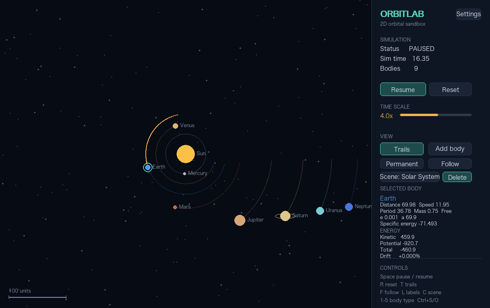

# OrbitLab (Python)

2D solar-system orbital sandbox implemented with Python and Pygame. It uses a softened Newtonian N-body model and Velocity Verlet integration.



## Run

```bash
python -m pip install -r requirements.txt
python main.py
```

Run these commands from the repository root. Preferences, scene files, and
screenshots default to this directory beside `config.py`, regardless of the
current working directory. You can also launch the app from another directory
with `python /absolute/path/to/OrbitLab/main.py`.

F12 saves an image named `orbitlab_YYYYMMDD_HHMMSS.png` beside the scripts.
The image shown above is a captured F12 screenshot renamed to `screenshot.png`
for this release. Generated preferences, scene saves, and timestamped screenshots
are ignored by Git.

## Project structure

```text
OrbitLab/
├── .gitignore
├── AGENTS.md          # Project collaboration rules
├── MEMORY.md          # Project state and verification history
├── LICENSE
├── README.md
├── requirements.txt
├── screenshot.png
├── main.py            # Application entry point
├── config.py          # Shared configuration, text, and file paths
├── bodies.py          # Body dataclass and scene factories
├── physics.py         # N-body simulation, energy, and collisions
├── camera.py          # Coordinate transforms and zoom
└── app.py             # Application state, events, UI, and rendering
```

Dependencies remain one-way: `main → app → {physics, camera, config, bodies}`,
`physics → {bodies, config}`, and `bodies → config`. `camera` only depends on
Pygame. `App` remains a single class.

## Controls

- `Space`: pause / resume
- `R`: reset
- `T`: toggle trails
- `Always trails`: keep a longer trail history, trimming older points when the limit is reached
- `F`: follow the selected body with the camera
- `L`: toggle labels; `C` or the Scene button cycles presets
- `N`: pause if running, then advance one physics step
- `F12`: save a screenshot of the current window
- `+` / `-`: change time scale (`0.1x` to `100x`)
- `[` / `]`: decrease / increase selected mass
- `,` / `.`: decrease / increase selected radius
- `P`: toggle selected body fixed state
- `X`: delete selected body
- `Ctrl+S` / `Ctrl+O`: save / load `scene.json`
- `1`-`5`: select body type before creating a body (`5` = Star)
- Mouse wheel: zoom around cursor
- Drag the canvas: pan
- Click a body: inspect its state
- Toggle `Add body`, then click-drag on empty canvas to create a probe and give it an initial velocity

Open `Settings` in the upper-right panel to switch between English and
Chinese, toggle the starfield, enable or disable collision merging, or restore
default preferences.

The `Delete` button beside the scene selector removes the selected body.
Primary bodies can also be deleted; the notification includes `(primary)`.

The panel also reports kinetic energy, potential energy, total energy, and
relative energy drift. Bodies merge on contact while conserving mass and
linear momentum.

Available presets are Solar System, Binary Star, Earth-Moon, and Figure-8;
clicking the Scene button opens a direct selection menu.
Selecting a body also shows a cached dashed trajectory prediction and basic
two-body orbital elements. Prediction is skipped when there are more than
80 bodies and resumes on the next prediction refresh at 80 or fewer.

## License

MIT License. Copyright (c) 2026 zhFelix. See [LICENSE](LICENSE).
